# Zentrale Profil-Anfragen-Inbox (SUN-RQ)

Architektur-Freeze zu Ticket #2 des Vorhabens „Zentrale Anfragen-Inbox fuer alle
SUN-Portale". Dieses Dokument ist fuer die Tickets #3 bis #12 verbindlich: wer
davon abweichen will, aendert zuerst hier.

Stand: 21.10.2026 · Autor: Dimitri (Backend) · Abnahme: Enes

---

## 1. Methodik der Analyse — und was sie nicht hergibt

Verlangt war eine Stichprobe von 50 E-Mails der letzten vier Wochen aus den
Portal-Postfaechern. Die Postfaecher sind ein fremder Dienst; nach der Vorgabe
in `CLAUDE.md` („Externe Dienste und Konten") wird darauf ohne ausdrueckliche
Zustimmung von Enes nicht zugegriffen — auch nicht lesend. **Die Mail-Stichprobe
wurde deshalb nicht gezogen.**

Ausgewertet wurde stattdessen der vollstaendige Bestand derselben Anfragen, wie
er heute im Produkt liegt und lokal gespiegelt vorliegt (`sun:db:pull`, Stand
21.10.2026, 23 Tenants):

* **50 Aenderungs-/Loeschanfragen** aus `company_edit_suggestions` (Tenant-DBs)
  — zufaellig genau die verlangte Stichprobengroesse, weil das die
  Gesamtmenge ist.
* **135 Uebernahmeantraege** aus `claim_requests` (Tenant-DBs).
* **488 712 Betriebe**, davon 109 mit Inhaber (`companies.user_id`), 11
  verifiziert, 13 Premium.

Zwei Einschraenkungen, die fuer die Verifikationsregeln wichtig sind:

1. **Absenderadressen sind lokal anonymisiert.** `config/db-pull.php`
   ersetzt `company_edit_suggestions.reporter_email` durch
   `melder<id>@example.test` und `companies.email` durch
   `firma<id>@example.test`. Die lokal gemessene Domain-Match-Quote von 100 %
   und die Firmen-E-Mail-Abdeckung von 100 % sind **Artefakte der
   Anonymisierung**, keine Messwerte. Wie oft ein Absender tatsaechlich die
   hinterlegte Firmenadresse nutzt, ist aus dem Repo nicht feststellbar.
2. **Die E-Mail-Anfragen selbst liegen nirgends im System.** Sie werden heute
   direkt im Postfach bearbeitet, es gibt keine Ablage. Die Typverteilung unten
   gilt fuer den Formularweg; der Mail-Weg kann anders aussehen.

Folge fuer die Architektur: Die Regeln sind so gebaut, dass eine fehlende
Firmen-E-Mail und ein Freemail-Absender **der Normalfall** sein duerfen, ohne
dass der Ablauf stehenbleibt (Abschnitt 4). Die echte Verteilung wird mit dem
Pilot in #12 gemessen und hier nachgetragen.

---

## 2. Stichproben-Auswertung

### 2.1 Typverteilung (50 Anfragen, Freitext gelesen)

| Typ | Anzahl | Anteil |
|---|---:|---:|
| `change` — Aenderung eines oder mehrerer Felder | 24 | 48 % |
| `delete` — Eintrag soll weg (geschlossen, insolvent, Inhaber verstorben, Widerspruch) | 17 | 34 % |
| `other` — Bewertungsstreit („meine Bewertung ist 5,0 und nicht 4,8") | 4 | 8 % |
| `other` — unbrauchbar, Testeingabe („e") | 5 | 10 % |

Das bestaetigt die Annahme des Vorhabens (je ca. 50 % Aenderung/Loeschung). Die
10 % Muell sind der Grund, warum `OTHER` kein Auto-Apply kennt und warum das
Formular in #4 Turnstile braucht.

### 2.2 Betroffene Felder

Das Formular kennt heute nur vier Werte in `company_edit_suggestions.field`:

| `field` | Anzahl |
|---|---:|
| `other` | 32 |
| `description` | 10 |
| `address` | 5 |
| `phone` | 3 |

`other` mit 64 % ist der Befund: **das heutige Formular passt nicht zu dem, was
die Leute wollen.** Tatsaechlich genannt (Stichwortsuche in allen 50
Freitexten, Mehrfachnennung moeglich — 12 Anfragen nennen mehr als ein Feld):

| Feld | Nennungen |
|---|---:|
| Adresse / Firmensitz | 11 |
| Telefon | 9 |
| Website | 7 |
| Beschreibung / Langtext | 6 |
| E-Mail | 5 |
| Bewertung (kein Profilfeld) | 5 |
| Oeffnungszeiten | 3 |
| Firmenname / Firmierung | 3 |
| Logo / Bild | 2 |
| Leistungen | 1 |
| Kategorie | 1 |

Textlaenge: Median 64 Zeichen, Maximum 950. Jede dritte Anfrage ist ein Satz —
die KI-Klassifikation (#6) muss mit einem Halbsatz umgehen, nicht mit einem
Formular in Prosa.

### 2.3 Absender und Claim-Zustand

* Alle 50 Anfragen tragen eine Absenderadresse (Pflichtfeld im Formular).
* Domain-Match: nicht messbar, siehe Abschnitt 1.
* **Nur 6 von 50 Anfragen (12 %) betreffen ein bereits geclaimtes Profil.** Der
  Regelfall ist also ein Betrieb ohne Konto — Verifikation darf **kein Login
  voraussetzen**. Das ist die zentrale Konsequenz fuer #4 und #6.

### 2.4 Bearbeitung heute

* `company_edit_suggestions`: **49 von 50 offen** (`pending`), eine genehmigt.
  Der Rueckstand ist komplett; die aelteste offene Anfrage ist aus 03/2026.
* `claim_requests`: **111 von 135 offen**, 24 genehmigt. Vom Antrag bis zur
  Freigabe liegen im Median **203 Stunden (8,5 Tage)**, im schlimmsten Fall
  1766 Stunden (74 Tage).
* Anfragen verteilen sich auf 13 der 23 Portale; zwei Portale tragen 31 der 50
  (e917… 22, bba4… 9).

Das ist die Vergleichsbasis fuer #12: Median-Bearbeitungszeit 8,5 Tage,
Rueckstand 160 offene Vorgaenge.

---

## 3. Feld-Whitelist fuer die Auto-Uebernahme

Verbindlich in `config/profile-requests.php` → `auto_apply_fields`. Eine
verifizierte `change`-Anfrage wird **nur dann** ohne Enes uebernommen, wenn
*jedes* Feld ihres Diffs auf dieser Liste steht. Ein einziges Feld daneben und
die ganze Anfrage bleibt zur Freigabe liegen — kein Teil-Apply.

**Automatisch (12 Schluessel):**

| Schluessel | Ziel | Warum unkritisch |
|---|---|---|
| `tel` | `companies.tel` | Kontaktdatum, kein Ranking-Einfluss |
| `email` | `companies.email` | dito |
| `website` | `companies.website` | dito; 7 Nennungen, haeufigster echter Fehler |
| `opening_hours` | `company_opening_hours` | reine Serviceinfo |
| `description` | `companies.description` (+ `description_source`) | Backup existiert (`company_description_backups`) |
| `services` | `company_services` | Freitextliste am Profil |
| `logo` | Media-Collection `logo` | Bild, reversibel |
| `social_facebook`, `social_instagram`, `social_linkedin`, `social_youtube` | `companies.social_*` | Links |
| `video_url` | `companies.video_url` | Link |

**Nie automatisch — immer Freigabe durch Enes:**

| Feld | Grund |
|---|---|
| `name` | Firmenname steht in Titel, H1, JSON-LD und Sitemap; Umbenennung ist ein SEO-Vorgang |
| `street`, `house_no`, `zipcode`, `city_id` | Adresse haengt an der Stadtseite; ein Stadtwechsel aendert `seo.city.active_count.*`, Stadtseiten-Listen und interne Verlinkung |
| `categories` | Kategoriezuordnung steuert Suchergebnisse und Kategorieseiten |
| `user_id` (Inhaber) | das ist ein Claim, kein Change — Typ `claim` |
| `rating`, `rating_count` | berechnet aus `reviews`, kein editierbares Feld. Die 5 Bewertungs-Beschwerden sind `other` und werden per Vorlage beantwortet, nicht angewendet |
| `is_premium`, `is_verified`, `is_active`, `slug` | Systemfelder |

Begruendung der Grenze: automatisch darf, was sich ohne Index-Wirkung
zurueckdrehen laesst. Alles, was Titel, URL oder Stadtzuordnung beruehrt, kostet
im Fehlerfall Rankings und wird nicht automatisiert.

---

## 4. Verifikationsregeln

Eine Anfrage gilt als vom Betrieb autorisiert, wenn genau einer der drei Wege in
`VerificationMethod` erfolgreich war. Reihenfolge der Pruefung:

**1. `sender_domain` (nur Quelle `email`)**
Die Domain der Absenderadresse entspricht der Domain von `companies.email`
*oder* der Host von `companies.website`. Gilt **nicht**, wenn die Domain in
`profile-requests.verification.freemail_domains` steht (25 Anbieter gelistet) —
`info@gmail.com` beweist nichts. Trifft die Regel, geht die Anfrage direkt von
`classified` auf `verified`, ohne Mail an den Betrieb.

**2. `magic_link` (Regelweg)**
Ein Einmal-Link geht an die **beim Profil hinterlegte** Firmen-E-Mail, nie an
die Adresse des Anfragenden. Das ist der ganze Trick: wer den Link klickt, hat
Zugriff auf das Firmenpostfach. Gueltig `verification_ttl_hours` = **72
Stunden**; danach `expired`. Hoechstens
`verification.max_links_per_company_per_day` = **3** Links je Profil und Tag,
sonst wird das Formular zum Mailwerfer gegen fremde Betriebe.

**3. `manual`**
Greift, wenn das Profil keine Firmen-E-Mail hat, der Link dreimal ins Leere
lief, oder der Anfragende nachweislich ein Dritter ist („Im Auftrag von …",
Nachlass, Insolvenzverwalter — in der Stichprobe mehrfach). Enes bestaetigt im
Panel, ggf. nach Nachweis als Anhang. Handgepruefte Anfragen laufen **nie** in
die Auto-Regeln (`VerificationMethod::allowsAutoApply()` ist `false`): wer von
Hand prueft, entscheidet auch gleich.

**Ausdrueckliche Nicht-Regeln:**

* Login/Claim ist keine Voraussetzung — 88 % der Anfragen kommen von Profilen
  ohne Konto (2.3).
* Eine verifizierte Anfrage ist eine Autorisierung, keine Pflicht: `verified`
  darf weiterhin nach `rejected` (Zustandsautomat, Abschnitt 8).
* Turnstile (#4) ist Spamabwehr am Formular und **kein** Verifikationsweg.

---

## 5. Karenzfrist

`deletion_grace_hours` = **48 Stunden**.

Eine verifizierte `delete`-Anfrage wird nicht sofort ausgefuehrt. Der Betrieb
bekommt eine Bestaetigungsmail mit Termin und **Stornolink** (#10); ein Klick
setzt die Anfrage auf `cancelled`. Erst danach startet die Loeschpipeline (#8)
automatisch (#9).

Warum 48 h: DSGVO Art. 12 Abs. 3 gibt einen Monat Zeit, 48 Stunden sind
deutlich darunter und damit unkritisch. Gleichzeitig faengt die Frist den Fall
ab, der in der Stichprobe vorkommt — jemand verlangt die Loeschung im Aerger und
will anschliessend doch nur eine Korrektur. Eine Loeschung ist der einzige
Vorgang hier, der sich nicht zurueckdrehen laesst.

Aenderungen haben **keine** Karenzfrist; sie sind reversibel.

---

## 6. Lösch-Matrix

Was an einem Profil haengt und was bei einer Loeschung damit passiert.
Mengenangaben aus dem lokalen Spiegel (Summe ueber 23 Portale) zeigen, wo es
weh tut. Umsetzung: `DeleteCompanyAction` in #8, jeder Schritt mit Eintrag in
`request_events`.

| Datenart | Ort | Aktion | Menge |
|---|---|---|---|
| Profil | `companies` | **loeschen** (hartes Delete, protokolliert; `is_active=false` genuegt nicht fuer Art. 17) | 488 712 |
| Oeffnungszeiten | `company_opening_hours` | loeschen (FK cascade) | 1 971 085 |
| Leistungen, Referenzen, Termine | `company_services`, `company_references`, `company_events` | loeschen (cascade) | 5 752 287 |
| Bilder (Logo, Cover, Galerie) | `media` + Tenant-Storage `storage/tenant<uuid>/app/public` | Media-Eintraege **und Dateien samt Conversions** loeschen (`Media::delete()`, nicht nur die DB-Zeile) | 873 438 |
| Bild-Auslieferung | Cloudflare-Cache vor dem Ursprung | **nicht automatisch loeschbar** — kein Cloudflare-Zugang im Projekt. Die Bild-URLs sind nach dem Loeschen 404; der Kanten-Cache laeuft mit seiner TTL aus. Wird im Protokoll als offener Punkt vermerkt und bei Bedarf von Enes gepurgt (Auftragsverarbeiter nach Art. 17 Abs. 2) | — |
| Bewertungen | `reviews` | loeschen (cascade). Fremde Texte, die aber ohne Bezugsobjekt nichts mehr aussagen; Inhaberantworten (`owner_response`) sind personenbezogen | 1 729 174 |
| Anfragen (Marktplatz) | `company_inquiries` | **anonymisieren**, nicht loeschen: `contact_name`, `contact_email`, `contact_phone`, Freitexte leeren, `contact_purged_at` setzen. Datensatz und Abrechnungsbezug bleiben (Aufbewahrungspflicht); endgueltige Loeschung laeuft ueber die bestehende Frist `leads.exclusive.retention_months` = 12 | 912 |
| Exklusive Leads | `company_leads` | wie oben anonymisieren | 1 |
| Kontingente | `lead_quota_usages` | loeschen | 31 |
| Statistik | `company_stats_daily`, `tracking_events`, `tracking_daily_stats` | loeschen. Profilbezogene Zahlen ohne Profil sind wertlos; Portalsummen werden neu berechnet | 2 241 580 |
| Stellenanzeigen | `jobs`, `job_applications` | Anzeigen loeschen, Bewerbungen **anonymisieren** (`applicant_*`, `message`) — fremde Bewerberdaten | 23 |
| Uebernahmeantraege | `claim_requests` + Nachweisdokumente in der Media-Collection `claim_documents` | loeschen, Dateien mit | 135 |
| Verifikationen | `company_verifications` | loeschen, Dokument mit (`document_purged_at`) | 0 |
| Platzierungen | `featured_placements` | loeschen | 0 |
| Beschreibungs-Historie | `company_description_backups`, `profile_description_rewrites` | loeschen | 0 |
| Aenderungsvorschlaege | `company_edit_suggestions` | loeschen; `reporter_email` ist fremd-personenbezogen | 50 |
| Inhaberkonto | `users` (Central-DB) | **bleibt.** Das Konto ist nicht das Profil. Nur die Tenant-Rolle wird entzogen (`TenantPermissionService`) und `companies.user_id` entfaellt mit dem Profil | 109 betroffen |
| Favoriten | — | **existiert nicht.** Kein Favoriten-Feature im Repo; die Zeile im Ticket laeuft ins Leere | — |
| Sitemap | `tenants:generate-sitemap` / `GenerateTenantSitemapJob` | nach dem Loeschen neu erzeugen. Das Profil fliegt heraus, Stadt- und Kategorieseiten bekommen neues `lastmod` | — |
| Suchmaschinen | IndexNow (`api.indexnow.org`) | Profil-URL pingen. `App\Guide\Publishing\IndexNowClient` kann heute nur Ratgeber-URLs; #8 braucht denselben Weg fuer Profil-URLs. Google nimmt IndexNow nicht an und bekommt die Entfernung ueber die Sitemap und den 410 |
| Alte URL | Portal-Route `portal.companies.show` (+ `.show.city`) | **410 Gone** ausliefern statt 404 — eindeutiges Signal „dauerhaft weg". Ein 410-Weg existiert heute nicht und wird in #8 gebaut |
| Stadtseiten-Zaehler | Cache `seo.city.active_count.<cityId>`, `sun-v2.home.service_counts`, `portal.stats.total`, `portal.stats` | leeren |
| Weitere Caches | `company.<id>.jsonld`, `city.<cityId>.jsonld.page1`, `portal.categories.city.<cityId>`, `portal.cities.category.*`, `portal.cities.related.<cityId>`, `portal.cities.sidebar`, `portal.cities.hero`, `sun-v2.cities.index.v3`, `sun-v2.home.cities`, `sun-v2.home.top_rated_pool`, `portal.featured_companies`, `portal.random_companies`, `sun-v2.claim.claimed_count`, `sun-v2.login.companies` | leeren |
| Protokoll | `request_events` (Central-DB) | **bleibt dauerhaft.** Nachweis der Erledigung nach Art. 17; enthaelt nur Betriebsname, Portal, Zeitpunkt, ausgefuehrte Schritte — keine Kontaktdaten |

**Cache-Falle:** Der File-Cache wird je Tenant umgebogen
(`App\Listeners\Tenant\SetTenantStorageUrl`). Ein `Cache::forget` aus dem
Central-Panel trifft den Tenant-Cache nicht. Jede Leerung muss in
`$tenant->run(...)` laufen — in #8 nicht vergessen.

**Mitteilung an den Betrieb:** Nach Abschluss geht eine Bestaetigung mit der
Liste der geloeschten Datenarten raus (#10) samt Hinweis, dass die Entfernung
aus Suchmaschinen-Caches einige Tage dauern kann.

---

## 7. Der Claim-Flow heute

* **Tabelle:** `claim_requests` je Tenant-DB
  (`database/migrations/tenant/2026_02_27_000001_create_claim_requests_table.php`).
  Spalten: `company_id`, `user_id` (Central-User, bewusst ohne FK), `status`,
  `comment`, `rejection_reason`, `reviewed_by`, `reviewed_at`.
* **Model:** `App\Models\Portal\ClaimRequest` — Status als Konstanten
  (`pending`, `approved`, `rejected`, `cancelled`), Zustandsuebergaenge als
  Methoden (`approve`, `reject`, `resubmit`, `cancel`), Media-Collection
  `claim_documents` (PDF/JPEG/PNG, Disk `public`), Katalog von sechs
  Ablehnungsgruenden.
* **Service:** `App\Services\ClaimService` — legt den Antrag an, prueft „schon
  geclaimt" und „ein Konto besitzt hoechstens einen Betrieb", vergibt bei
  Freigabe die Tenant-Rolle (`TenantPermissionService`) und verschickt
  `ClaimRequestNotification`, `ClaimApproved`, `ClaimRejected`.
* **UI:** `Livewire\Portal\ClaimModal`, `ClaimForm`, `ClaimVerification`;
  Route `GET /firma/{slug}/verifizierung` → `CompanyController::claimVerification`.
  Freigabe durch Enes unter `/verwaltung/claim-antraege`
  (`VerwaltungClaimController`, `Livewire\Verwaltung\ClaimTable`).
* **Warum manuell:** Der Nachweis ist ein hochgeladenes Dokument
  (Gewerbeschein o. ae.), das jemand ansehen muss. Es gibt keinen maschinellen
  Pruefschritt — darum liegen 111 Antraege offen und dauern im Median 8,5 Tage.

**Entscheidung fuer #6:** Der Claim-Flow wird **nicht migriert und nicht
abgeloest**, sondern **gemappt**. `claim_requests` bleibt die fachliche Tabelle
des Uebernahmevorgangs (Rolle, Dokument, Besitzregel); zusaetzlich entsteht je
Antrag eine `profile_requests`-Zeile mit `type=claim`,
`source=claim_flow` und `external_ref` auf `claim_requests.id`, damit der
Vorgang in der zentralen Inbox sichtbar ist und dieselbe Verifikation nutzen
kann. Begruendung: ein Umzug der Tabelle in die Central-DB waere eine
Datenwanderung ueber 23 Datenbanken mit 135 Antraegen und haengenden Medien —
viel Risiko fuer wenig Gewinn, und die Migrationsvorgabe des Sets erlaubt nur
additive Schritte. Der Zusatznutzen ist die Automatik: trifft Magic-Link oder
Domain-Match, gibt `ClaimService::approveClaimRequest()` den Antrag ohne Enes
frei; ohne Treffer bleibt es beim Dokument von Hand.

---

## 8. Zustandsautomat

Abgebildet in `App\ProfileRequests\Enums\RequestStatus::allowedTransitions()`.

```
            (source=email)                (source=form|claim_flow)
                  │                                 │
                  ▼                                 │
               ┌─────┐   KI-Klassifikation (#6)      │
               │ new │ ────────────────────────┐     │
               └─────┘                         ▼     ▼
                                          ┌────────────┐
                                          │ classified │
                                          └────────────┘
                              Magic-Link │          │ Domain-Match
                                 nötig   │          │ trifft
                                         ▼          │
                          ┌───────────────────────┐ │
                          │ awaiting_verification │ │
                          └───────────────────────┘ │
                     TTL abgelaufen │      │ Link   │
                                    ▼      ▼ geklickt
                              ┌─────────┐ ┌──────────┐
                              │ expired │ │ verified │
                              └─────────┘ └──────────┘
                                               │
                           Auto-Regel (#9) /   │
                           Ein-Klick im Panel  ▼
                                          ┌─────────┐
                                          │ applied │
                                          └─────────┘

Aus jedem offenen Zustand zusätzlich:
  → rejected   (Enes lehnt ab; auch aus `verified`)
  → cancelled  (Anfragender storniert, z. B. Stornolink in der Karenzfrist)

Endzustände: applied, rejected, expired, cancelled.
```

Regeln:

* `new` gilt nur fuer `source=email`. Formular und Claim-Dialog starten in
  `classified`, weil Typ, Betrieb und Diff dort strukturiert vorliegen.
* `classified → verified` ohne Zwischenschritt ist erlaubt und der Fall
  `sender_domain`.
* `verified → rejected` bleibt offen: verifiziert heisst autorisiert, nicht
  berechtigt.
* `expired` gibt es nur aus `awaiting_verification`.
* Jeder Uebergang schreibt eine Zeile in `request_events` (#3) mit Akteur
  (`system`, `user`, `enes`), altem und neuem Zustand.

---

## 9. Datenmodell

**Entscheidung: `profile_requests` und ihre drei Nebentabellen liegen in der
Central-DB** (Verbindung `central`, `DB_CONNECTION=central`; Models mit
`Stancl\Tenancy\Database\Concerns\CentralConnection`).

Begruendung: Die Inbox soll alle Portale auf einer Seite zeigen. Lagen die
Anfragen in den Tenant-DBs, kostete jede Listenansicht 23 Verbindungswechsel
und 23 Abfragen, Sortierung und Paginierung ueber Portale hinweg waeren nicht in
SQL machbar. Der Preis ist die fehlende Fremdschluesselintegritaet nach
`companies` — `tenant_id` und `company_id` sind Referenzen ohne FK, genau wie
`claim_requests.user_id` es heute umgekehrt macht. Ein geloeschter Betrieb
laesst seine Anfragen also stehen; das ist gewollt, denn das Protokoll der
Loeschung muss die Loeschung ueberleben.

Tabellen (Details und Indizes in #3):

* **`profile_requests`** — eine Zeile je Vorgang. Felder: `tenant_id`
  (Tenant-Schluessel), `company_id` (nullable, bis die Zuordnung steht),
  `type` (`RequestType`), `source` (`RequestSource`), `status`
  (`RequestStatus`), `verification_method` (`VerificationMethod`, nullable),
  `verification_token_hash` (nur SHA-256, siehe unten),
  `verification_expires_at`, `verified_at`, `verified_email`,
  `requester_name`, `requester_email`, `requester_phone`, `message`
  (Freitext), `raw_email_path`, `ai_confidence`, `ai_summary`,
  `ai_reply_draft`, `auto_applicable`, `external_ref` (z. B.
  `claim_requests.id`), `grace_until` (Ende der Karenzfrist), `applied_at`,
  `applied_by` (null = automatisch), `rejected_reason`, Timestamps.
  Indizes auf `(status, created_at)`, `(tenant_id, company_id)`,
  `(requester_email)`, `(type, status)`, `(verification_token_hash)` und
  `(grace_until)`.

  Umgesetzt in #3 mit zwei Abweichungen von der ersten Fassung dieses
  Abschnitts: der Freitext heisst `message` statt `body`, und der
  KI-Vorschlag steht in den drei Spalten `ai_confidence`, `ai_summary` und
  `ai_reply_draft` statt in einem JSON-Feld `ai_suggestion` — der
  Antwortentwurf wird im Panel bearbeitet und versendet (#10), ein
  JSON-Teilfeld waere dafuer kein Formularfeld. Der vorgeschlagene Diff
  liegt ohnehin in `request_changes`.

  **Der Verifikationstoken liegt nur gehasht in der Tabelle**
  (`ProfileRequest::hashToken()`, SHA-256). Den Klartext gibt
  `requestVerification()` einmalig zurueck; danach existiert er
  ausschliesslich im Magic-Link der versendeten Mail. Nachgesehen wird er
  ueber `ProfileRequest::findByVerificationToken()`.

  **`status` aendert sich nur ueber die Methoden des Automaten**
  (`markClassified()`, `requestVerification()`, `verify()`, `apply()`,
  `reject()`, `markExpired()`, `cancel()`). Jede schreibt in derselben
  Transaktion genau eine Zeile in `request_events`; ein direktes
  `$request->status = ...` lehnt `ProfileRequestObserver` mit
  `RequestTransitionException` ab. Der Betrieb wird mit
  `ProfileRequest::company()` aufgeloest, Arbeit im Portal laeuft ueber
  `ProfileRequest::runInTenantContext()` — beide kapseln den Kontextwechsel
  im `TenantCompanyResolver`, der Aufrufer behaelt seinen eigenen Kontext.
* **`request_changes`** — der Diff, eine Zeile je Feld: `request_id`, `field`
  (Whitelist-Schluessel aus Abschnitt 3), `old_value`, `new_value`,
  `accepted` (Checkbox je Zeile im Panel, #11).
* **`request_events`** — das Protokoll: `request_id`, `event`, `actor_type`,
  `actor_id`, `from_status`, `to_status`, `payload` (JSON), `created_at`.
  Append-only, wird nie geloescht.
* **`request_attachments`** — Anhaenge und Rohmail: `request_id`, `path`,
  `mime`, `size`, `is_raw_mail`, `purge_after` (= `created_at` +
  `retention_days`).

Die Einstellungen stehen vollstaendig in `config/profile-requests.php`.

---

## 10. Postfach-Setup

**Nicht ausgefuehrt.** Ein Sammelpostfach anlegen und Weiterleitungen in 21
Portal-Domains einrichten heisst, in fremden Konten (Mailhoster, DNS/Cloudflare)
Einstellungen zu aendern. Das ist nach `CLAUDE.md` ohne ausdrueckliche
Zustimmung von Enes untersagt, und ein Zugang liegt im Projekt auch nicht vor.
**Dieser Teil des Tickets ist eine Aufgabe fuer Enes**, nicht fuer die Agenten;
er ist kein Nachfolgeticket.

Was dafuer vorbereitet ist: der vollstaendige Sollstand (unten), die Config
(`profile-requests.mailbox`) und die Variablen in `.env.example`. Sobald die
Zugangsdaten im Passwort-Manager liegen, braucht #5 nur noch die `.env`.

**Sollstand:**

1. Postfach `anfragen@sanitaerfinden.com` auf der zentralen Domain
   (`sanitaerfinden.com` ist `CENTRAL_DOMAIN` und `APP_URL` der Installation).
   Eigenes Postfach, nicht Alias — der Poller braucht IMAP.
2. Je ausgeliefertes Portal eine Weiterleitung der bestehenden Kontaktadresse
   (`info@`/`kontakt@`) auf dieses Postfach. **Weiterleiten, nicht umziehen:**
   die Adresse bleibt im Impressum und auf der Portalseite gueltig.
   Weiterleitung statt 21 IMAP-Zugaenge heisst: ein Zugang, ein Poller, ein
   Rueckstand.
3. Die Weiterleitung muss `Delivered-To` bzw. `X-Original-To` setzen — daraus
   liest #5 das Zielportal (`mailbox.portal_headers`, Reihenfolge
   `Delivered-To`, `X-Original-To`, `X-Forwarded-To`, `To`). Greift keine
   Kopfzeile, entscheidet die KI (#6); bleibt auch das unklar, landet die
   Anfrage ohne Portal in der Inbox und Enes ordnet sie zu. Beim Einrichten
   also pruefen, dass der Hoster die Kopfzeile nicht entfernt.
4. Ordner `Verarbeitet` im Postfach. Der Poller **verschiebt** eingelesene
   Mails dorthin und loescht nichts — ein Fehler im Poller darf keine Anfrage
   vernichten.
5. IMAP-Zugangsdaten in den Passwort-Manager, von dort in die `.env` der
   Produktion. Nie ins Repo: der Secret-Scan lehnt jedes Literal ab,
   `env()` wird ohne Vorgabewert gelesen.
6. SPF/DKIM der zentralen Domain beachten: weitergeleitete Mails brechen SPF.
   Deshalb wird am Postfach nicht hart auf SPF-Fail gefiltert, sonst gehen
   Anfragen verloren.

Variablen (alle leer in `.env.example`): `REQUESTS_MAILBOX_ADDRESS`,
`REQUESTS_IMAP_HOST`, `REQUESTS_IMAP_PORT`, `REQUESTS_IMAP_ENCRYPTION`,
`REQUESTS_IMAP_VALIDATE_CERT`, `REQUESTS_IMAP_USERNAME`,
`REQUESTS_IMAP_PASSWORD`, `REQUESTS_IMAP_FOLDER`,
`REQUESTS_IMAP_PROCESSED_FOLDER`, `REQUESTS_CLAUDE_MODEL`.

`webklex/laravel-imap` ist mit #5 installiert (Version 6.2).

---

## 10a. E-Mail-Ingestion: der Poller (#5)

`requests:fetch-mail` laeuft alle fuenf Minuten (`routes/console.php`,
`withoutOverlapping`, `onOneServer`) und liest die **ungelesenen** Mails des
Sammelpostfachs. Kein IDLE: bei gut 20 Mails am Tag ist eine stehende
Verbindung mehr Betriebsrisiko als Gewinn, und das Abnahmekriterium lautet
„innerhalb von fuenf Minuten".

**Ablauf je Mail**

1. **Reservieren.** Die Message-ID wird in `request_mail_log` eingetragen,
   bevor irgendetwas anderes passiert. Die Spalte `message_id_hash`
   (SHA-256) traegt einen Unique-Index — das ist die Dedupe-Sperre. Eine
   Mail ohne Message-ID bekommt einen Ersatzschluessel aus Absender,
   Betreff, Datum und Groesse. Der Zwischenstand heisst `processing`;
   bleibt er stehen, ist ein Lauf mittendrin abgebrochen, und die Mail wird
   trotzdem kein zweites Mal verarbeitet.
2. **Filtern** (`IngestionFilter`). Verworfen werden: `Auto-Submitted`
   ungleich `no` und die verbreiteten Auto-Reply-Kopfzeilen, `Precedence:
   bulk|junk|list|auto_reply`, leerer `Return-Path` (Bounce), Newsletter
   (`List-Id`, `List-Unsubscribe`, `List-Post`), gesperrte Absender
   (Config plus `REQUESTS_BLOCKED_SENDERS`) und Absender wie `noreply@`,
   an die keine Rueckfrage moeglich waere. Ergebnis: Zeile mit
   `outcome = discarded` und Grund — **keine** Anfrage.
3. **Thread pruefen** (`ThreadMatcher`), in dieser Reihenfolge:
   `In-Reply-To`/`References` gegen die Message-IDs unserer ausgehenden
   Mails, dieselben Kopfzeilen gegen das Eingangsprotokoll, zuletzt die
   Betreffsmarke `[REQ-{id}]`. Treffer heisst: Ereignis
   `requester_replied` an der bestehenden Anfrage, keine neue.
4. **Anlegen** (`MailToRequestMapper`): Anfrage mit `source = email`,
   `status = new`, `type = other` (bis die Klassifikation in #6 laeuft),
   Absender, Text (HTML wird zu lesbarem Text gewandelt), Rohmail als
   `.eml` und die Anhaenge.
5. **Abschliessen:** Flag `Seen` setzen, Mail nach `Verarbeitet`
   verschieben. Geloescht wird im Postfach nie.

**Portal-Erkennung** (`TenantFromRecipient`): die Empfaengerkopfzeilen aus
`mailbox.portal_headers` werden der Reihe nach gelesen, die Adresse des
Sammelpostfachs selbst wird uebersprungen, und die Domain der verbleibenden
Adresse wird gegen `tenants.domain` gestellt. Genau ein Treffer ergibt das
Portal; mehrere Treffer in derselben Kopfzeile lassen `tenant_id` leer —
raten waere hier schlimmer als nichts eintragen, denn eine Loeschung im
falschen Portal ist nicht rueckholbar. Fuer Hoster, die die urspruengliche
Adresse verlieren, gibt es `mailbox.recipient_tenant_map` (leer im
Auslieferungszustand).

**Konvention fuer ausgehende Mails (#10):** Betreff traegt `[REQ-{id}]`,
und die Message-ID lautet `<req-{id}-{zufall}@domain>`. Beides zusammen
macht Antworten zuordenbar, auch wenn ein Mailprogramm den Betreff
verstuemmelt (Muster in `ingestion.subject_tag_pattern` und
`ingestion.outgoing_message_id_pattern`).

**Anhaenge:** uebernommen werden nur Bilder und PDF
(`ingestion.allowed_attachment_mimes`). Massgeblich ist der aus dem Inhalt
ermittelte Typ, nicht der deklarierte `Content-Type` — eine fremde Mail
sagt uns nicht, was in ihrer Datei steht. Zu gross (ueber
`max_attachment_mb`) oder falscher Typ: Ereignis `attachment_rejected` mit
Dateiname, Typ, Groesse und Grund; die Anfrage bleibt bestehen. Alles liegt
unter `storage/app/private/requests/{id}/`, nie oeffentlich, und faellt nach
`retention_days` (90) dem Lauf `requests:purge-raw-mail` zum Opfer —
Anfrage, Diff und Protokoll bleiben.

**Stoerungen:** Verbindungs- und Anmeldefehler beenden den Lauf und zaehlen
in `PollerHealth` hoch. Nach drei Fehlschlaegen in Folge (eine Viertelstunde
ohne Abruf) geht **eine** Mail an `REQUESTS_ALERT_RECIPIENTS` — danach ist
Ruhe, bis ein Lauf wieder durchgeht. Liegen keine Empfaenger vor, gehen die
Alarme an alle nicht gesperrten Administratoren. Der Zaehler steht im
`file`-Cache, weil der Standardstore im Tenant-Kontext auf eine Datenbank
ohne `cache`-Tabelle zeigen kann. Eine einzelne unverarbeitbare Mail haelt
den Lauf nicht auf; sie steht als `processing` im Protokoll und der Fehler
im Log.

**Ohne Postfach pruefen:**
`php artisan tinker --execute='require "scripts/requests-ingestion-trockenlauf.php";'`
spielt neue Mail, Auto-Reply, Duplikat und Thread-Antwort gegen den echten
Command durch; ersetzt ist nur der IMAP-Zugriff. Das Skript spricht keinen
fremden Dienst an und raeumt hinterher auf.

---

## 11. Was dieses Ticket geliefert hat

| Datei | Inhalt |
|---|---|
| `docs/profile-requests.md` | dieses Dokument |
| `config/profile-requests.php` | Whitelist, Karenzfrist, TTL, Modell, Anhangsgrenze, Rohmail-Aufbewahrung, Postfach, Verifikation |
| `app/ProfileRequests/Enums/RequestType.php` | `change`, `delete`, `claim`, `other` |
| `app/ProfileRequests/Enums/RequestSource.php` | `form`, `email`, `claim_flow` |
| `app/ProfileRequests/Enums/RequestStatus.php` | acht Zustaende + `allowedTransitions()` |
| `app/ProfileRequests/Enums/VerificationMethod.php` | `magic_link`, `sender_domain`, `manual` |
| `.env.example` | Block `REQUESTS_*` |

### Dazugekommen mit #5 (E-Mail-Ingestion)

| Datei | Inhalt |
|---|---|
| `app/Console/Commands/RequestsFetchMail.php` | Poller, alle 5 Minuten |
| `app/Console/Commands/RequestsPurgeRawMail.php` | Aufbewahrungsfrist der Rohmails |
| `app/ProfileRequests/Ingestion/ImapMailFetcher.php` | IMAP: lesen, markieren, verschieben |
| `app/ProfileRequests/Ingestion/IngestionFilter.php` | Auto-Reply, Newsletter, gesperrte Absender |
| `app/ProfileRequests/Ingestion/ThreadMatcher.php` | Antwort statt neuer Anfrage |
| `app/ProfileRequests/Ingestion/MailToRequestMapper.php` | Mail -> Anfrage, Rohmail, Anhaenge |
| `app/ProfileRequests/Ingestion/TenantFromRecipient.php` | Empfaengeradresse -> Portal |
| `app/ProfileRequests/Ingestion/MailHeaders.php` | Kopfzeilen lesen |
| `app/ProfileRequests/Ingestion/MailOutcome.php` | `processing`, `created`, `replied`, `discarded` |
| `app/ProfileRequests/Ingestion/PollerHealth.php` | Fehlerzaehler und Alarmmail |
| `app/ProfileRequests/Models/RequestMailLog.php` + Migration | Eingangsprotokoll, Dedupe |
| `scripts/requests-ingestion-trockenlauf.php` | Abnahme ohne Postfach |

## 11a. Loeschpipeline (#8)

`App\Companies\Deletion\DeleteCompanyAction` ist der **einzige** Weg, ein
Firmenprofil zu loeschen. Panel (`/verwaltung/firmen`, Controller und
Livewire-Tabelle), Auto-Regel nach Karenzfrist (#9) und
`php artisan company:delete {tenant} {company}` laufen alle hier durch. Der
alte Panel-Weg — Oeffnungszeiten, Kategorien, Bilder, Soft Delete — ist
ersetzt; einen zweiten, kuerzeren Pfad gibt es nicht mehr.

### Schritte

Reihenfolge und Zusammensetzung stehen in
`config('profile-requests.deletion.steps')`. Jeder Schritt ist eine Klasse
unter `app/Companies/Deletion/Steps/` und erfuellt
`App\Companies\Deletion\DeletionStep`: `plan()` beschreibt, `run()` tut,
beides wiederholbar. **Eine neue Datenart ist ein neuer Schritt**, kein
Anhaengsel an einem bestehenden.

| # | Schritt | Was passiert |
|---|---|---|
| 1 | `soft_delete_profile` | `is_active=false`, Soft Delete, `deleted_reason`, `hard_delete_after = +30 Tage`; `slug` und `google_places_id` werden freigegeben (Unique-Index) und im Original nach `pre_deletion_json` gelegt |
| 2 | `remove_media` | Logo, Cover, Galerie — `Media::delete()` je Datei, damit Dateien und Conversions im Tenant-Storage wirklich verschwinden; `logo_path` geleert |
| 3 | `remove_reviews` | Bewertungen samt `owner_response`; `rating` und `rating_count` auf 0 |
| 4 | `purge_related` | Oeffnungszeiten, Leistungen, Referenzen, Termine, Statistiken (3 Tabellen), Kontingente, Platzierungen, Beschreibungs-Historie, Aenderungsvorschlaege, Kategoriezuordnung; Stellenanzeigen nach Anonymisierung der Bewerbungen; Verifikationsnachweise samt Datei auf der privaten Disk; Uebernahmeantraege samt `claim_documents` |
| 5 | `anonymize_leads` | `company_inquiries` und `company_leads`: Kontaktfelder und `answers` leeren, `contact_purged_at` setzen. Datensatz und Abrechnungsbezug bleiben |
| 6 | `register_gone_url` | Beide URL-Muster in `gone_urls` — ab jetzt **410** |
| 7 | `invalidate_caches` | 13 Portal-Schluessel, Profil-JSON-LD, Stadt- und Kategorie-Schluessel; laeuft im Tenant-Kontext, weil der File-Cache je Portal umgebogen wird |
| 8 | `regenerate_sitemap` | `GenerateTenantSitemapJob`; `queue` (Standard), `sync` oder `off` ueber `profile-requests.deletion.sitemap` bzw. `--sitemap=` |
| 9 | `ping_indexnow` | `App\Guide\Publishing\IndexNowClient` fuer die Profil-URLs. Erreicht Bing, Yandex, Seznam; Google nimmt IndexNow nicht an und erfaehrt die Entfernung ueber Sitemap und 410 |

**Ein Fehler haelt die Pipeline nicht auf.** Scheitert ein Schritt, steht die
Meldung in seiner Protokollzeile und die uebrigen laufen weiter — lieber acht
von neun Datenarten weg als keine. Der Lauf gilt dann als unvollstaendig
(`ok=false`, Panel zeigt eine Warnung mit der `run_id`) und ist einfach
wiederholbar.

Keine umfassende Transaktion: die Schritte sprechen Dateien, HTTP und zwei
Datenbanken an, ein Rollback waere ab der ersten geloeschten Bilddatei
ohnehin unmoeglich. Stattdessen ist jeder Schritt idempotent.

### Protokoll

* **`deletion_log`** (Tenant-DB, append-only): je Schritt eine Zeile mit
  `run_id`, `step`, `status` (`ok`/`skipped`/`failed`), `message`, `payload`,
  `duration_ms`, `started_at`, `finished_at`, dazu `company_id`,
  `company_name` und `company_path` als Kopie. Die Zeilen bleiben auch nach
  dem harten Loeschen stehen — sie sind der Nachweis nach Art. 17. Zum
  Abschluss kommt eine Zeile `step = run` mit der Zusammenfassung.
* **`request_events`** (Central-DB): gehoert der Lauf zu einer Anfrage,
  bekommt sie je Schritt ein `note`-Ereignis, dazu `mail_sent` und —
  **nur bei fehlerfreiem Lauf** — den Statuswechsel nach `applied`. Bleibt
  ein Schritt offen, bleibt der Vorgang offen; eine halbe Loeschung gilt
  nicht als erledigt.

### 410 statt 404

`App\Http\Middleware\GoneUrls` haengt an den beiden Profilrouten in
`routes/tenant.php` (vor `TrackCompanyPageView`, damit eine geloeschte Seite
keinen Seitenaufruf zaehlt) und liefert `resources/views/errors/410.blade.php`
mit `X-Robots-Tag: noindex`. Die Pfadliste kommt aus `gone_urls`, gecacht
ueber `TenantCache::key('portal.gone_urls')` fuer eine Stunde — im Normalfall
also ein Cache-Treffer und keine Abfrage.

Die Middleware steht an der Route und nicht in der `web`-Gruppe: Gruppen-
Middleware laeuft vor den Route-Middlewares, und der Tenancy-Initializer
sitzt an der Routengruppe — in der `web`-Gruppe gaebe es noch kein Portal und
damit keine Tabelle.

**Warum nicht einfach 404:** „nicht gefunden" laesst Google die URL
monatelang weiter abfragen und derweil im Index stehen. 410 heisst
„dauerhaft weg". Fuer einen Antrag nach Art. 17 ist genau das der Punkt.

### Neueintrag und Zurueckholen

* Derselbe Betrieb kann sich **sofort neu eintragen**: Schritt 1 gibt `slug`
  und `google_places_id` frei, der Unique-Index kollidiert nicht mit dem
  soft-geloeschten Datensatz. `Company::created` ruft
  `GoneUrlRegistry::releaseOnReuse()` — belegt der neue Eintrag einen Pfad
  aus `gone_urls`, faellt die 410-Regel dafuer weg. Der Aufruf prueft erst
  den Cache und kostet bei leerer Tabelle keine Abfrage, ein Import mit
  19 600 Betrieben also auch keine 19 600.
* `Company::restored` ruft `CompanyRestoration::afterRestore()`: `slug`,
  `google_places_id` und `is_active` kommen aus `pre_deletion_json` zurueck,
  `deleted_reason` und `hard_delete_after` werden geleert, die 410-Regeln des
  Profils aufgehoben. Zurueckgeholt wird der **Eintrag**, nicht sein Inhalt —
  Bilder, Bewertungen und Statistiken sind endgueltig weg.

### Hard Delete nach 30 Tagen

`php artisan tenants:run companies:hard-delete-due` laeuft taeglich 02:30
(`routes/console.php`) und loescht die Profile endgueltig, deren
`hard_delete_after` erreicht ist. Davor ist der Soft Delete das Netz gegen
eine Fehlbedienung im Panel; danach muss die Zeile weg, weil `is_active=false`
fuer Art. 17 nicht genuegt. `gone_urls` und `deletion_log` bleiben.

**Dafuer musste eine Kaskade weichen:** `company_inquiries.company_id` und
`company_leads.company_id` haben mit `cascadeOnDelete` gehangen — das harte
Loeschen haette die gerade anonymisierten Datensaetze mitgenommen und die
Anonymisierung nach einem Monat wirkungslos gemacht, ohne dass es auffaellt.
Die Migration `tenant/2026_10_22_000007_relax_lead_company_foreign_keys.php`
macht beide Spalten nullable mit `nullOnDelete`. Nach dem Hard Delete bleibt
die anonyme Zeile mit `company_id = NULL` stehen: Status, Score,
Eingangsdatum, Abrechnungsbezug — ohne Personenbezug und ohne Betrieb. Die
Panel-Listen fragen immer ueber die `company_id` eines bestehenden Betriebs,
dort erscheint sie also nirgends. Endgueltig geloescht wird sie ueber die
bestehende Frist `leads.exclusive.retention_months` (Standard 12 Monate).

### Bestaetigungsmail

`App\ProfileRequests\Mail\DeletionCompletedMail` (View
`emails/profile-requests/deletion-completed.blade.php`, Sie-Form, Layout
`mail.sun.layout`) geht an `profile_requests.requester_email`, sobald der Lauf
durch ist. Inhalt: was geloescht wurde, der Hinweis, dass Google die Seite
erst beim naechsten Crawl entfernt, der Link auf das Google-Entfernungstool
und der Satz, dass ein Neueintrag moeglich ist. Eine Loeschung von Hand im
Panel verschickt nichts — ohne Anfrage gibt es keine Adresse.
**Wortlaut noch von Enes abzunehmen** (Abschnitt 12).

### Testlauf (21.10.2026, lokaler Mandant 47 „Gartenbauer", sun.test)

Betrieb #12187 „Franz Stelzer Gartenbau" (8 Bewertungen, 6 Oeffnungszeiten,
30 Termine, 25 Tagesstatistiken, 33 Tracking-Tageszeilen, 1 angelegter Lead).

| Pruefung | Ergebnis |
|---|---|
| `company:delete 47 12187 --dry-run` | 9 Schritte mit Mengen, nichts geaendert |
| Lauf 1 | 6 ok, 2 skipped, **1 failed** — `remove_reviews` lief gegen `rating` NOT NULL. Genau wie vorgesehen liefen die uebrigen Schritte weiter, der Fehler stand in `deletion_log`. Behoben (0 statt NULL) |
| Wiederholung | 0 Fehler, Schritte melden „schon erledigt" statt zu scheitern |
| Vollstaendiger Lauf mit `--request=8 --sitemap=sync` | 8 ok, 1 skipped (IndexNow aus), 0 failed, 19,1 s |
| Profil-URL | `/12187-franz-stelzer-gartenbau` → **410**, `X-Robots-Tag: noindex`; unbekannte URL weiter 404 |
| Bilder | 0 Media-Eintraege (Betrieb hatte keine), `logo_path` geleert |
| Bewertungen | 0 Zeilen in `reviews` |
| Leads | Zeile vorhanden, `contact_name/email/phone = NULL`, `answers = []`, `contact_purged_at` gesetzt, `status` und `quota_period` erhalten |
| Sitemap | URL in keiner der drei `sitemap*.xml` |
| Protokoll | 41 Zeilen in `deletion_log` ueber alle Laeufe; Anfrage #8 mit 9 `note`-Ereignissen, `mail_sent`, `applied` |
| Bestaetigungsmail | rendert, Betreff „Ihr Eintrag wurde gelöscht — GartenbauerFinden", sechs Datenarten aufgelistet |
| Neueintrag | gleicher Name und Slug ohne Unique-Kollision anlegbar |
| Zurueckholen | `slug`, `google_places_id`, `is_active` wieder im Original, `gone_urls` leer, Profilseite wieder **200** |
| Hard Delete | `companies:hard-delete-due` Trockenlauf listet das faellige Profil, scharfer Lauf loescht es; Lead bleibt mit `company_id = NULL`, `gone_urls` und `deletion_log` bleiben |
| `vendor/bin/phpstan` | keine Fehler in den neuen Klassen |

**IndexNow blieb in beiden Laeufen abgeschaltet** (`GUIDE_INDEXNOW_ENABLED=false`).
Ein echter Ping geht an `api.indexnow.org` und damit an einen fremden Dienst;
der Schritt ist nur gegen die Schnittstelle des Clients und gegen den
`skipped`-Pfad geprueft. Ein Ping im Scharfbetrieb braucht die Zustimmung von
Enes (AGENTS.md, „Externe Dienste und Konten").

Die Testdaten sind hinterher entfernt (`gone_urls`, `deletion_log`,
Testanfrage, Test-Lead). Betrieb #12187 ist im lokalen Spiegel hart geloescht
— ein `db:pull` holt ihn zurueck.

### Dateien (#8)

| Datei | Zweck |
|---|---|
| `app/Companies/Deletion/DeleteCompanyAction.php` | der eine Loeschweg |
| `app/Companies/Deletion/DeletionStep.php` | Vertrag eines Schritts |
| `app/Companies/Deletion/DeletionContext.php` | Lauf-Zustand, Notizbuch der Schritte |
| `app/Companies/Deletion/StepResult.php`, `StepStatus.php`, `DeletionResult.php` | Ergebnisse |
| `app/Companies/Deletion/DeletionLogger.php` | `deletion_log` + `request_events` |
| `app/Companies/Deletion/GoneUrlRegistry.php` | `gone_urls` schreiben, lesen, cachen |
| `app/Companies/Deletion/CompanyRestoration.php` | Nachlese beim Zurueckholen |
| `app/Companies/Deletion/Models/DeletionLogEntry.php`, `GoneUrl.php` | die beiden Tabellen |
| `app/Companies/Deletion/Steps/*.php` | die neun Schritte |
| `app/Http/Middleware/GoneUrls.php` + `resources/views/errors/410.blade.php` | 410 |
| `app/Console/Commands/CompanyDelete.php` | `company:delete` |
| `app/Console/Commands/CompanyHardDeleteDue.php` | `companies:hard-delete-due` |
| `app/ProfileRequests/Mail/DeletionCompletedMail.php` + View | Bestaetigung |
| `database/migrations/tenant/2026_10_22_000005_create_gone_urls_and_deletion_log_tables.php` | `gone_urls`, `deletion_log` |
| `database/migrations/tenant/2026_10_22_000006_add_deletion_columns_to_companies_table.php` | `deleted_reason`, `hard_delete_after`, `pre_deletion_json` |
| `database/migrations/tenant/2026_10_22_000007_relax_lead_company_foreign_keys.php` | Kaskade der Leads geloest |

---

## 11b. Diff-Komponente des Panels (#11)

`App\Livewire\Central\RequestDiffTable` ist die Diff-Ansicht einer Anfrage.
Sie steht in der Detailansicht der Inbox (#7), kennt aber nur die Anfrage-ID
und holt sich alles selbst — damit sie auch in einem Modal oder in einer
Vorschau stehen kann.

```blade
@livewire('central.request-diff-table', ['requestId' => $request->id])

{{-- Erledigter Vorgang: nur ansehen, keine Haken, keine Bearbeitung --}}
@livewire('central.request-diff-table', ['requestId' => $request->id, 'readOnly' => true])
```

### Aufbau

| Spalte | Inhalt |
|---|---|
| Feld | Anzeigename, darunter der Schluessel aus `request_changes.field`; Felder ausserhalb von `config('profile-requests.auto_apply_fields')` tragen das Abzeichen **manuelle Freigabe** |
| Aktuell | Wert aus dem Profil (`old_value`) |
| Neu | eingereichter Wert (`new_value`), mit **Wert bearbeiten** |
| Uebernehmen | Haken, steht in `request_changes.accepted` |

### Vorbelegung des Hakens

* **an** im Normalfall — auch bei Feldern ausserhalb der Whitelist. Die
  bekommen den Hinweis, aber keinen stillen Vorbehalt.
* **aus**, wenn `profile_requests.ai_confidence` unter 0,7 liegt
  (`RequestDiffTable::AI_CONFIDENCE_THRESHOLD`). Ueber der Tabelle steht dann
  ein Hinweis. Ein unsicherer KI-Vorschlag soll nicht durch Wegklicken
  uebernommen werden, sondern durch Hinsehen.

Die Vorbelegung wird beim ersten Oeffnen **gespeichert** (`accepted` war
null). Sonst stuende im Panel ein Haken, den die Uebernahme (#7/#9) nicht
sieht, und #9 muesste die Regel ein zweites Mal nachbauen.

### Wort-Diff

`App\ProfileRequests\Support\WordDiff` vergleicht serverseitig **Woerter**
(`Jfcherng\Diff\SequenceMatcher` aus `jfcherng/php-diff`) und gibt beide
Seiten als HTML zurueck: links nur `<del>`, rechts nur `<ins>`. Jedes Token
wird einzeln escaped, der einzige unescaped Anteil sind die Marken selbst.
Der Leerraum bleibt als eigenes Token erhalten, damit im Ergebnis wieder der
Originaltext steht und nicht eine normalisierte Fassung.

Angewendet wird er nur, wenn beide Seiten Text sind und eine davon mindestens
60 Zeichen hat (`WordDiff::worthwhile()`). Eine Telefonnummer wird nicht
wortweise korrigiert — da sind alt und neu nebeneinander schneller zu lesen
als eine Einfaerbung.

### Strukturierte Felder

`App\ProfileRequests\Support\FieldRenderer` macht aus jedem JSON-Wert einen
Beschreiber (`empty`, `scalar`, `text`, `rows`, `list`, `image`), den das
Blade rendert. Kein Feld kommt als JSON im Panel an:

* **Oeffnungszeiten** — eine Zeile je Wochentag in der Reihenfolge von
  `CompanyOpeningHour::DAYS`, Wert `08:00 – 17:00`, `Geschlossen` oder
  `Keine Angabe`. Beide Diff-Formen werden gelesen: Liste von Datensaetzen mit
  `day_of_week` (Formular, #4) und Abbildung Tag => Zeiten (KI, #6).
* **Leistungen** — Name, Ab-Preis aus `price_from` (Cent, deutsches Format wie
  in `CompanyService`) und die Beschreibung darunter.
* **Kategorien** und alles ohne bekannten Feldtyp — flache Liste.

### Inline-Bearbeitung

**Wert bearbeiten** gibt es nur fuer Text und Skalare
(`FieldRenderer::isEditable()`). Oeffnungszeiten, Leistungen, Kategorien und
Bilder sind davon ausgenommen — eine JSON-Textarea waere eine Einladung zum
kaputten Datensatz.

Gespeichert wird `request_changes.new_value`, dazu **eine** Protokollzeile:

```
request_events: event=diff_edited  actor_type=user  actor_id=<Bearbeiter>
payload: {"field":"tel","from":"0221 9988771","to":"0221 9988772"}
```

Damit steht im Protokoll, dass der uebernommene Wert nicht der eingereichte
ist — Voraussetzung dafuer, dass eine Rueckfrage des Betriebs spaeter
beantwortbar bleibt.

### Bild-Anhaenge

Bild-Anhaenge (`request_attachments`, `mime` beginnt mit `image/`) stehen als
Thumbnail unter der Tabelle, je Bild **Logo / Galerie / Ignorieren**. Die Wahl
liegt in `request_attachments.image_role` und nicht nur im Livewire-Zustand —
eine Entscheidung, die ein Seitenwechsel verliert, ist keine. Logo gibt es nur
einmal; die bisherige Wahl wird dabei Galeriebild.

Das Thumbnail ist ein Data-URI
(`RequestAttachment::thumbnailDataUri()`, WebP, max. 160 px, ca. 3 kB) und
keine URL: die Anhaenge liegen auf der privaten Platte, und eine oeffentliche
URL dafuer waere ein neuer Weg nach draussen fuer Dateien, die uns ein Fremder
geschickt hat. Das verkleinerte Bild liegt als `thumb-{id}-{groesse}.webp`
neben dem Original und geht mit `purge()` mit.

### Breakpoint

Kein `<table>`. Ab **1024 px** (`lg`) stehen Feld, Aktuell, Neu und der Haken
in einem vierspaltigen Grid nebeneinander; **ab 1023 px abwaerts** stapeln sie
sich untereinander, jede Zelle mit eigener Beschriftung. Gemessen bei 1023 px:
`scrollWidth == clientWidth`, also kein horizontales Scrollen.

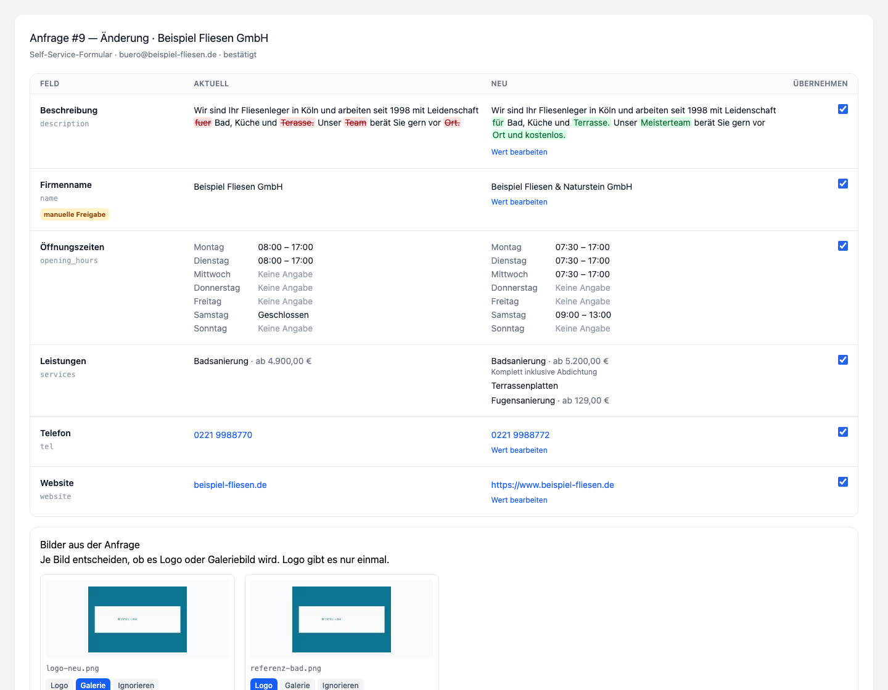

*Desktop (1440 px): Feld, Aktuell, Neu, Haken nebeneinander. `description`
mit Wort-Diff, `name` mit dem Abzeichen „manuelle Freigabe", Oeffnungszeiten
und Leistungen lesbar statt als JSON.*

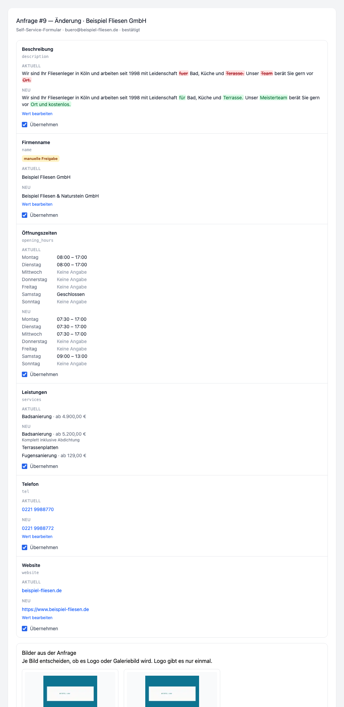

*1023 px: gestapelt — Feld, darunter Aktuell, darunter Neu, darunter der
Haken. Kein Quer-Scrollen.*

### Dateien (#11)

| Datei | Inhalt |
|---|---|
| `app/Livewire/Central/RequestDiffTable.php` | Komponente: Haken, Inline-Bearbeitung, Bildrollen |
| `resources/views/livewire/central/request-diff-table.blade.php` | Grid, Breakpoint, Thumbnails |
| `resources/views/livewire/central/partials/request-diff-value.blade.php` | ein Diff-Wert, lesbar gerendert |
| `app/ProfileRequests/Support/FieldRenderer.php` | Beschreiber je Feldtyp, Labels, Whitelist-Pruefung |
| `app/ProfileRequests/Support/WordDiff.php` | Wort-Diff als `<ins>`/`<del>` |
| `database/migrations/2026_10_22_000006_add_image_role_to_request_attachments_table.php` | `request_attachments.image_role` |
| `app/ProfileRequests/Enums/RequestEventType.php` | neu: `diff_edited` |

---

## 11c. KI-Klassifikation und Verifikation (#6)

Der Weg einer eingegangenen Mail nach dem Poller (#5):

```
requests:fetch-mail  ->  ClassifyRequest (Queue)
                            |-> CompanyCandidateFinder   (Tenant-DB, Top 5)
                            |-> RequestClassifier        (Claude, strikt JSON)
                            |-> request_changes          (accepted = null)
                            |-> status: new -> classified
                            \-> RequestVerifier
                                   |-> sender_domain -> verified
                                   |-> magic_link    -> awaiting_verification + Mail
                                   \-> manual        -> awaiting_verification
```

Formular-Anfragen (#4) starten direkt in `classified` und gehen ohne
KI-Schritt in denselben `RequestVerifier`
(`App\Livewire\Portal\ProfileRequestDialog`).

### Was der KI-Schritt darf und was nicht

Er liefert **einen Vorschlag**: `profile_requests.ai_confidence`,
`ai_summary`, `ai_reply_draft` und Zeilen in `request_changes` mit
`accepted = null`. Er schreibt nie in ein Profil und versendet nie eine
E-Mail. Der Antwortentwurf liegt im Panel; abgeschickt wird er dort von Hand
(Vorgabe 5 des Ticketsets).

Damit kein Modell eine ID erfinden kann, laeuft die Firmensuche **vor** dem
Aufruf serverseitig (`CompanyCandidateFinder`): E-Mail exakt und per Domain,
Telefon auf Ziffern normalisiert (letzte 7 Stellen), Firmenname per LIKE aus
Signaturzeilen und gross geschriebenen Wortgruppen. Die KI waehlt nur aus
diesen hoechstens fuenf Kandidaten; eine `company_id` ausserhalb der Liste
wird verworfen und die Zuversicht auf 0 gesetzt.

Uebernommen wird die Zuordnung erst ab
`classification.min_confidence` = **0,7**. Darunter bleibt `company_id` leer,
und die Kandidaten stehen samt Trefferbegruendung im Protokollereignis
`ai_suggested` — daraus baut das Panel (#7) die Auswahlliste.

Ein unbrauchbares JSON ist **kein** Fehlerfall: die Anfrage wird mit
`type=other`, Zuversicht 0 und einem Eintrag `fallback_reason` eingeordnet und
ist damit in der Inbox. Dasselbe gilt fuer einen fehlenden API-Schluessel.

### Modell

`profile-requests.claude_model`, Vorgabe **`claude-sonnet-5-5`**
(`REQUESTS_CLAUDE_MODEL` ueberschreibt). Der in #3 eingetragene Wert
`claude-sonnet-4-20250514` existiert fuer unseren Schluessel nicht mehr und
lieferte 404 — die Klassifikation lief damit stumm in den Fallback. Zweite
Falle derselben Art: die aktuellen Modelle lehnen einen vorgegebenen
Antwortanfang (`assistant`-Prefill mit `{`) mit 400 ab. Der Prompt verlangt
deshalb reines JSON, und der Parser schneidet Begleittext und Codeblock weg.

Der Aufruf geht ueber die bestehende Anthropic-Integration: Schluessel und
Basis-URL aus `config/ai.php` (`ANTHROPIC_API_KEY`), kein neuer Client.

### Verifikation

| Weg | Bedingung | Ergebnis |
|---|---|---|
| `sender_domain` | Quelle `email`, Absenderadresse gleich `companies.email` oder gleiche Domain wie diese bzw. die Profil-Website, Domain **nicht** auf der Freemail-Liste | sofort `verified`, keine Mail |
| `magic_link` | Firmen-E-Mail am Profil hinterlegt, Tageslimit nicht erreicht | `awaiting_verification` + Mail an die Firmenadresse |
| `manual` | keine Firmen-E-Mail, Betrieb nicht zugeordnet, oder Tageslimit erreicht | `awaiting_verification`, Kennzeichen `manual`, Enes entscheidet |

Der Domain-Match gilt **nur** fuer Quelle `email` (Regel 1 in Abschnitt 4).
Beim Formular ist die Absenderadresse Eingabe und beweist nichts; dort fuehrt
immer der Magic-Link oder die Handpruefung. Die Freemail-Liste ist
`config('profile-requests.verification.freemail_domains')` **plus**
`resources/profile-requests/generic-email-domains.txt` (95 Zeilen, ohne
Deployment nachziehbar); eine Subdomain eines Anbieters zaehlt mit.

Links: `URL::temporarySignedRoute` auf der **Portal-Domain** — der Host muss
vor dem Signieren stimmen, und eine fremde Domain in der Bestaetigungsmail
eines Portals sieht aus wie Phishing. Zweite Sperre ist der Token-Hash
(SHA-256) in der Tabelle, verglichen mit `hash_equals`; der Klartext existiert
nur in der Mail. Routen in `routes/web.php`
(`/anfrage/{id}/bestaetigen/{token}`, `/anfrage/{id}/ablehnen/{token}`,
`POST /anfrage/{id}/neuer-link`), alle gedrosselt.

Ein abgelaufener Link zeigt „Link abgelaufen" samt Knopf „Neuen Link
anfordern" (`refreshVerificationToken()`, entwertet den alten) — er setzt den
Vorgang **nicht** auf `expired`. Das macht nur `requests:expire` (stuendlich
zur Minute 20): Vorgaenge mit verfallenem Link und solche, die ohne
Fortschritt in `new` oder `classified` liegengeblieben sind. Handgepruefte
Vorgaenge bleiben unberuehrt — dort wartet eine Entscheidung, kein Klick.
Dafuer kennt der Automat zwei zusaetzliche Uebergaenge: `new -> expired` und
`classified -> expired`.

### Claim-Automatik

`App\ProfileRequests\Actions\ApproveClaim` gibt eine **verifizierte**
Uebernahme ohne Enes frei und nutzt dafuer die bestehende Logik
(`ClaimService`), nicht eine zweite: Antrag anlegen bzw. den vorhandenen aus
dem Claim-Dialog nehmen (`external_ref`), Konto suchen oder anlegen, Rolle
`company_owner` vergeben, `ClaimApproved` verschicken, Vorgang auf `applied`.
Ein neues Konto bekommt keinen Passwortwert, sondern einen Link zum Setzen
(`Password::broker()->sendResetLink()`) — und zwar **ausserhalb** von
`Tenant::run()`, weil `password_reset_tokens` in der Central-DB liegt.
`claim_requests.reviewed_by` traegt in diesem Weg 0; dass es die Automatik
war, steht in `request_events`. Gehoert der Betrieb schon einem **anderen**
Konto, bricht die Aktion ab und der Vorgang wartet auf `verified` im Panel.

### Abnahmelauf (lokal, 21.10.2026)

`php artisan tinker --execute='require "scripts/requests-klassifikation-trockenlauf.php";'`
— sechs anonymisierte Beispielmails durch den echten Weg (nur der Mailversand
ist `Mail::fake()`, der KI-Aufruf ist echt). Portal `firmenfreund.de`,
Betrieb #1 aus dem lokalen Spiegel.

| Mail | Erwartet | Ergebnis |
|---|---|---|
| 1 Neue Telefonnummer, Absender = Firmenadresse | change, Diff `tel`, `sender_domain` | `change`, `company_id` 1, Zuversicht **0,97**, Diff `tel: 0721 338812 -> 0721 4471290` (`accepted = null`), **verified** ueber `sender_domain` |
| 2 Oeffnungszeiten + Website, Absender `@gmail.com` | change, zwei Diffs, kein Domain-Match | `change`, Zuversicht **0,55–0,6** -> `company_id` bleibt **leer**, Kandidaten im Protokoll, Diffs `opening_hours` und `website`, `awaiting_verification` (`manual`, weil ohne Zuordnung keine Firmenadresse feststeht) |
| 3 Loeschwunsch, Absender auf Firmendomain | delete mit Grund, `sender_domain` | `delete`, `company_id` 1, Zuversicht **0,85**, Grund in `ai_summary`, **verified** ueber `sender_domain` |
| 4 Uebernahmeantrag, Absender privat | claim, Magic-Link | `claim`, `company_id` 1, Zuversicht **0,9**, `awaiting_verification` + Mail an `firma1@example.test` |
| 5 Preisanfrage einer Agentur | other, keine Zuordnung | `other`, Zuversicht **0,1**, keine Zuordnung, `manual` |
| 6 Aenderung mit Firmenadresse im Text, Absender privat | Betrieb ueber die Adresse gefunden, Magic-Link | `change`, `company_id` 1, Zuversicht **0,93**, Diffs `email` + `tel`, Magic-Link-Mail an die Firmenadresse |

Dauer je Mail 3–10 Sekunden, deshalb laeuft die Klassifikation in der Queue
und nicht im Pollerlauf. Antwortentwurf und Zusammenfassung kamen in allen
sechs Faellen in brauchbarer Sie-Form.

Zusaetzlich von Hand geprueft (gleicher Lauf, Links ueber den Router):
Magic-Link-Klick setzt `verified_at`, `verified_email`,
`verification_method` und entwertet den Token; der zweite Klick zeigt „Schon
bestaetigt"; ein abgelaufener Link zeigt „Link abgelaufen" mit Knopf; eine
gefaelschte Signatur „Link nicht gueltig"; `requests:expire` setzt den
Vorgang auf `expired`; ein verifizierter Claim landet auf `applied`, der
Betrieb am neuen Konto, `claim_requests` auf `approved`, Freigabemail und
Passwortlink je einmal.

**Vorbehalt zum lokalen Spiegel:** dort sind alle Firmenadressen auf
`firma<id>@example.test` und alle Rufnummern auf einen Platzhalter
anonymisiert. Die Firmensuche ueber Telefon ist lokal deshalb ohne
Aussagekraft, und `example.test` steht nicht auf der Freemail-Liste — der
Domain-Match greift lokal leichter als auf der Produktion. Der Lauf auf
Staging mit echten Weiterleitungen gehoert zu #12.

### Dazugekommen mit #6 (Klassifikation und Verifikation)

| Datei | Inhalt |
|---|---|
| `app/ProfileRequests/Jobs/ClassifyRequest.php` | Job je Mail-Anfrage, speichert den Vorschlag, stoesst die Verifikation an |
| `app/ProfileRequests/Ai/RequestClassifier.php` | Prompt, Anthropic-Aufruf, strikter JSON-Parser mit Fallback |
| `app/ProfileRequests/Ai/ClassificationResult.php` | Ergebnis des Laufs |
| `app/ProfileRequests/Ai/CompanyCandidateFinder.php` | Firmensuche in der Tenant-DB, Top 5 |
| `app/ProfileRequests/Verification/RequestVerifier.php` | Domain-Match, Magic-Link, Handpruefung, Folgeautomatik |
| `app/ProfileRequests/Verification/SenderDomainMatcher.php` | Domain-Vergleich, Freemail-Liste |
| `app/ProfileRequests/Mail/VerifyRequestMail.php` | Bestaetigungsmail mit Magic- und Stornolink, `[REQ-id]` |
| `resources/views/emails/profile-requests/verify-request.blade.php` | deren Vorlage |
| `app/Http/Controllers/RequestVerificationController.php` | Klick, Storno, neuer Link |
| `resources/views/profile-requests/verification.blade.php` | Statusseite (bestaetigt, abgelehnt, abgelaufen, ungueltig) |
| `app/ProfileRequests/Actions/ApproveClaim.php` | Claim-Automatik ueber `ClaimService` |
| `app/Console/Commands/RequestsExpire.php` | `requests:expire`, stuendlich |
| `resources/profile-requests/generic-email-domains.txt` | Freemail-Pflegeliste |
| `scripts/requests-klassifikation-trockenlauf.php` | Abnahmelauf mit sechs Beispielmails |

---

## 11d. Mails an Betriebe und oeffentliche Statusseite (#10)

Sieben Mails und eine Seite. Alles, was ein Betrieb zu einem Vorgang zu
sehen bekommt, steht hier — im Panel (#7) bleibt, was ihn nichts angeht.

### Die sieben Mails

Alle sieben erben von `App\ProfileRequests\Mail\RequestMail` und teilen
deshalb vier Dinge, von denen jedes einzelne den Vorgang bricht, wenn es
fehlt:

| | Warum |
|---|---|
| `[REQ-{id}]` im Betreff | Der Poller (#5) haengt eine Antwort an den Vorgang, statt eine neue Anfrage anzulegen (`subject_tag_pattern`) |
| Message-ID `<req-{id}-{zufall}@domain>` | Zweiter, robusterer Weg ueber In-Reply-To (`outgoing_message_id_pattern`) — ueberlebt einen verstuemmelten Betreff |
| Reply-To auf `REQUESTS_MAILBOX_ADDRESS` | Die Antwort muss dort landen, wo der Poller liest. Ohne die Angabe setzt `SetPortalSender` die Kontaktadresse des Portals ein, und die Antwort versandet |
| Branding aus dem Tenant | Name und Markenfarbe kommen aus `tenants`, nie aus `config('app.name')`: die Mails laufen ueber die Queue und sehen dort kein Portal |

Layout ist `mail.sun.layout` — dasselbe wie bei den Premium-Mails, kein
zweites Mail-Layout. Der Fuss (Grussformel in Sie-Form, Statuslink,
Vorgangsnummer) liegt einmal in
`emails/profile-requests/partials/footer.blade.php`.

Anrede: **Sie**. Die Grussformel kommt aus
`portal.mail.sign_off_name_formal` („Ihr Team von :portal"), nicht aus
`sign_off_name` — das ist die Du-Fassung der Besuchermails und passt hier
nicht.

| Mail | Klasse | Wann | Empfaenger |
|---|---|---|---|
| Eingangsbestaetigung | `RequestReceivedMail` | Anfrage angelegt | Anfragender |
| Bestaetigung mit Magic-Link | `VerifyRequestMail` | Verifikation angestossen (#6) | **hinterlegte Firmen-E-Mail** |
| Loeschung angekuendigt | `DeletionScheduledMail` | Karenzfrist beginnt | Anfragender |
| Aenderung uebernommen | `ChangesAppliedMail` | Diff ganz oder teilweise uebernommen | Anfragender |
| Loeschung abgeschlossen | `DeletionCompletedMail` | Pipeline durchgelaufen (#8) | Anfragender |
| Abgelehnt | `RequestRejectedMail` | Ablehnung mit Grund (#7) | Anfragender |
| Uebernahme freigegeben | `ClaimApprovedMail` | nach `ApproveClaim` (#6) | Anfragender |

Zwei Dinge, die bewusst so sind:

* Die **Bestaetigungsmail** geht als einzige an die beim Profil hinterlegte
  Adresse, nicht an den Anfragenden — sonst bestaetigt sich jeder selbst.
  Die Eingangsbestaetigung geht dagegen an den Anfragenden und gibt nichts
  frei; sie sagt nur „angekommen" und wohin der Bestaetigungslink ging.
* Die **Aenderungsmail** trennt „uebernommen" und „noch offen". Panel (#11)
  und Auto-Regel (#9) uebernehmen zeilenweise; ohne die Trennung prueft der
  Betrieb sein Profil und schreibt ein zweites Mal.

Der Stornolink der **Loeschmail** zeigt auf die Statusseite und nicht auf den
Stornolink der Bestaetigungsmail: deren Token ist mit der Verifikation
entwertet (`ProfileRequest::verify()`).

### Statusseite

`/anfrage/{id}/status`, signiert, **ohne Ablauf**, `throttle:30,1`,
`noindex`. Komponente `App\Livewire\Public\RequestStatus`.

Ohne Ablauf, weil ein Vorgang Wochen laeuft: eine Adresse, die nach 72
Stunden ins Leere zeigt, erzeugt genau die Rueckfrage, die die Seite
ersparen soll. Dafuer steht dort nichts, was nicht der Betrieb selbst
eingereicht hat, und die Adresse des Anfragenden ist maskiert
(`MaskedEmail`).

Aufbau von oben nach unten: Stand, Handlung, Zeitstrahl, eingereichte Werte,
eigene Nachricht. Wer die Seite aus der Loeschmail aufruft, braucht den
Stornoknopf ohne Scrollen.

**Zeitstrahl** zeigt nur die Ereignisse, die den Betrieb betreffen —
eingegangen, in Pruefung, Bestaetigung angefordert, bestaetigt, Nachricht
eingegangen, erledigt, abgelehnt, zurueckgezogen, abgelaufen. KI-Vorschlag,
Notizen, Mailprotokoll, Diff-Bearbeitung, verworfene Anhaenge und
Zuversichtswerte bleiben im Panel (`RequestStatus::VISIBLE_EVENTS`).

**Zwei Knoepfe**, nie beide gleichzeitig:

* *Loeschung stornieren* — Typ `delete`, Status `verified`, Karenzfrist
  laeuft noch.
* *Anfrage zurueckziehen* — jeder andere offene Vorgang.

Beide rufen `ProfileRequest::cancel()` auf, also Statuswechsel **und**
Protokollzeile in einer Transaktion, Akteur `requester`.

Die Seite haengt an keinem Theme und an keinem Vite-Bundle: von den 23
Portalen laufen nur 5 auf `sun-v2`, und `public/build/` ist nicht
versioniert. Huelle ist `profile-requests/page.blade.php` mit Inline-Stilen
nach sun-portal-design (zinc, weisse Karten, 16 px Radius, genau eine Farbe
— die Markenfarbe des Portals, Klickflaechen ab 44 px).

`POST /livewire/update` traegt keine Signatur. Die Knoepfe arbeiten deshalb
auf der Eigenschaft `requestId`, die Livewire mit einer Pruefsumme sichert —
ein fremder Vorgang laesst sich darueber nicht unterschieben.

### Abnahmelauf (lokal, 21.10.2026, Portal FirmenFreund, Markenfarbe #2D5A8E)

Alle sieben Mails gerendert, Statusseite ueber eine Kernel-Anfrage geholt:

```
[mail] received              6736 B  Betreff: Ihre Änderung ist eingegangen [REQ-55] — FirmenFreund | Reply-To: anfragen@firmenfreund.de
[mail] verify                7002 B  Betreff: Bitte bestätigen: Änderung an Ihrem Eintrag [REQ-55] — FirmenFreund | Reply-To: anfragen@firmenfreund.de
[mail] deletion-scheduled    6459 B  Betreff: Ihr Eintrag wird gelöscht — Sie können noch widersprechen [REQ-56] — …
[mail] changes-applied       6801 B  Betreff: Ihre Änderung ist übernommen [REQ-55] — …
[mail] deletion-completed    7312 B  Betreff: Ihr Eintrag wurde gelöscht [REQ-56] — …
[mail] rejected              6193 B  Betreff: Wir können Ihre Anfrage nicht umsetzen [REQ-55] — …
[mail] claim-approved        6342 B  Betreff: Ihr Eintrag gehört jetzt Ihnen [REQ-57] — …
[seite] change         /anfrage/55/status -> 200
[seite] delete-karenz  /anfrage/56/status -> 200
[seite] schutz         ohne Signatur -> 403
```

Die angelegten Vorgaenge sind danach wieder entfernt worden.

**Statusseite bei 360 px** (Chrome erzwingt auf macOS mindestens 500 px
Fensterbreite — aufgenommen in einem 360 px breiten iframe):

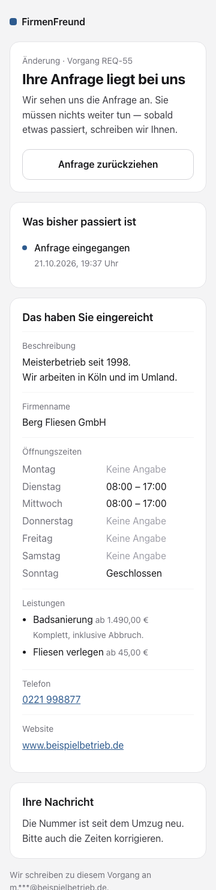

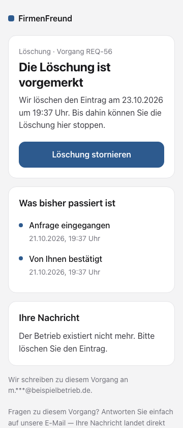

**Die sieben Mails** (600 px, Markenfarbe des Portals):

| | |
|---|---|
| Eingangsbestaetigung | 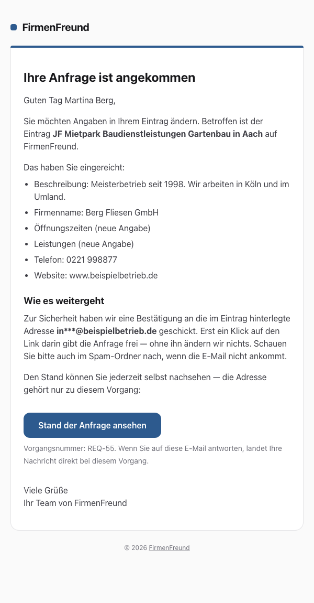 |
| Bestaetigung mit Magic-Link | 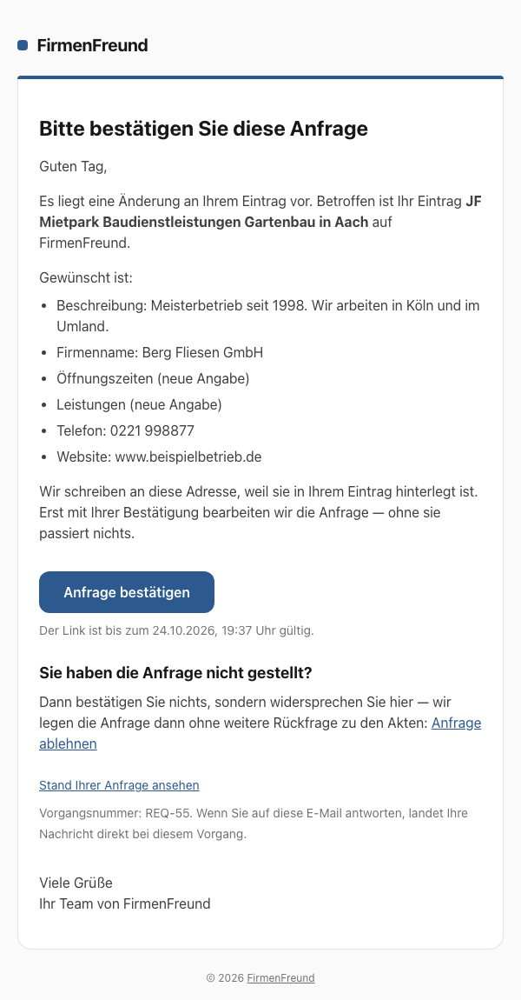 |
| Loeschung angekuendigt | 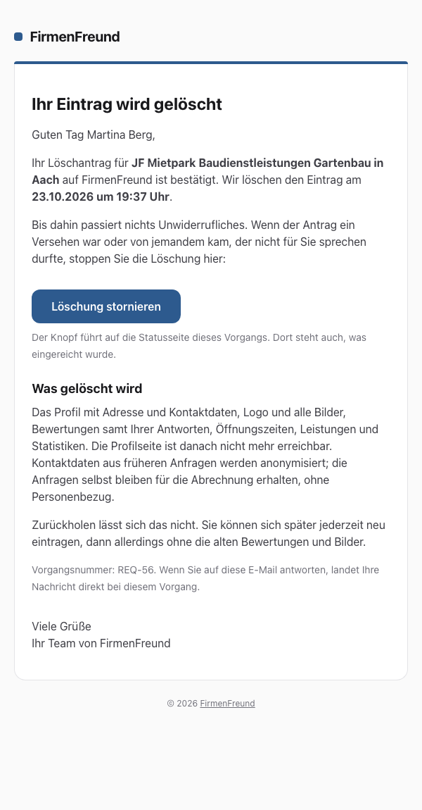 |
| Aenderung uebernommen | 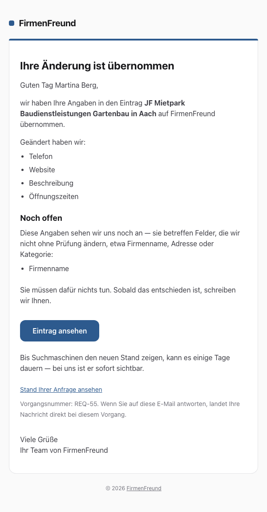 |
| Loeschung abgeschlossen | 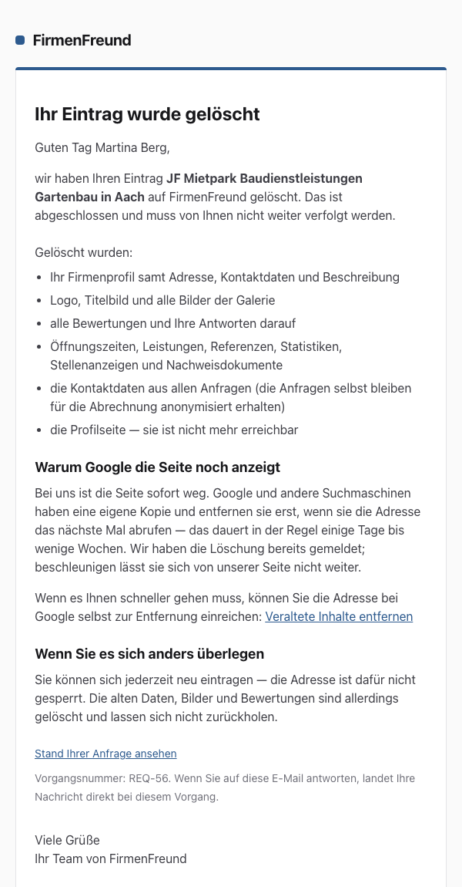 |
| Abgelehnt | 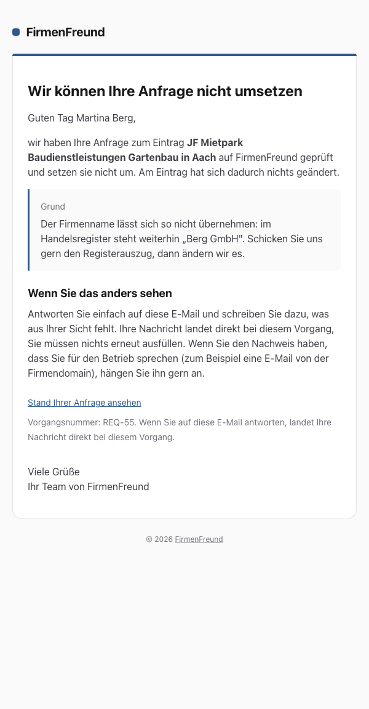 |
| Uebernahme freigegeben | 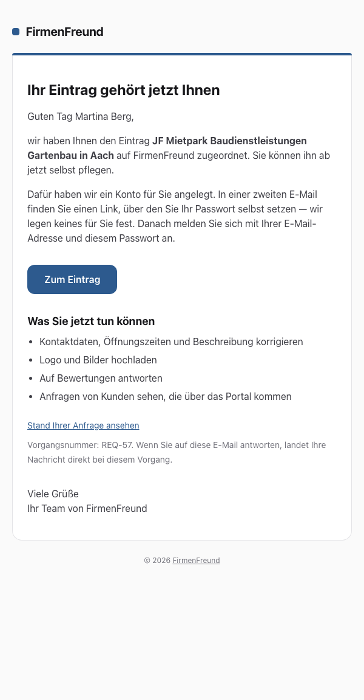 |

Darstellung in Gmail, Outlook und Apple Mail ist **nicht** geprueft: dafuer
braucht es Litmus oder ein Konto bei einem dieser Anbieter, und beides ist
ein fremder Dienst (CLAUDE.md, „Externe Dienste und Konten"). Das Risiko ist
gering, weil Layout, Buttons und Inline-Stile dieselben sind wie bei den
Premium-Mails (#16), die seit Monaten laufen.

### Wer die Mails verschickt

| Mail | Versandstelle | Stand |
|---|---|---|
| Bestaetigung mit Magic-Link | `RequestVerifier::sendMagicLink()` | laeuft (#6) |
| Loeschung abgeschlossen | `DeleteCompanyAction::notify()` | laeuft (#8) |
| Eingangsbestaetigung, Loeschung angekuendigt, Aenderung uebernommen, Abgelehnt, Uebernahme freigegeben | Panel-Aktionen (#7) und Auto-Regeln (#9) | Vorlagen stehen, Versandstelle kommt mit #7/#9 |

### Dateien (#10)

| Datei | Inhalt |
|---|---|
| `app/ProfileRequests/Mail/RequestMail.php` | Basis: Betreffsmarke, Message-ID, Reply-To, Branding, Diff in Worten |
| `app/ProfileRequests/Mail/RequestReceivedMail.php` | Eingangsbestaetigung |
| `app/ProfileRequests/Mail/DeletionScheduledMail.php` | Karenzfrist mit Stornoweg |
| `app/ProfileRequests/Mail/ChangesAppliedMail.php` | uebernommene und offene Felder |
| `app/ProfileRequests/Mail/RequestRejectedMail.php` | Ablehnung mit Grund |
| `app/ProfileRequests/Mail/ClaimApprovedMail.php` | Uebernahme mit Zugang |
| `resources/views/emails/profile-requests/*.blade.php` | die sieben Vorlagen |
| `resources/views/emails/profile-requests/partials/footer.blade.php` | gemeinsamer Fuss |
| `app/ProfileRequests/Support/RequestLinks.php` | signierte Statusadresse auf der Portal-Domain |
| `app/Livewire/Public/RequestStatus.php` | Statusseite: Stand, Zeitstrahl, Felder, Storno |
| `resources/views/livewire/public/request-status.blade.php` | deren Vorlage |
| `resources/views/profile-requests/page.blade.php` | Huelle ohne Theme und ohne Vite |
| `routes/web.php` | `portal.requests.status` |

---

## 11e. Auto-Regeln, Karenzfrist-Loeschung und Tagesdigest (#9)

Das Regelwerk laeuft **nach jeder erfolgreichen Verifikation**
(`RequestVerifier::markVerified()` -> `RuleRunner`). Es nimmt die erste Regel
aus `profile-requests.auto.rules`, deren `appliesTo()` zutrifft; greift keine,
bleibt der Vorgang auf `verified` und wartet im Panel. Das ist der Normalfall
und kein Fehler.

| Regel | Greift bei | Tut |
|---|---|---|
| `AutoApplyWhitelistedChanges` | Typ `change`, `verified`, Verifikation nicht `manual`, **jedes** Diff-Feld auf der Whitelist, Quelle `form` **oder** `ai_confidence >= auto.min_ai_confidence` (0,9), Betrieb nicht „manuell pruefen" | hakt alle Diff-Zeilen an, laeuft durch `ApplyChanges`, Status `applied` mit `applied_by = null`, Bestaetigungsmail |
| `ScheduleVerifiedDeletion` | Typ `delete`, `verified`, Verifikation nicht `manual`, noch keine Frist | `grace_until = jetzt + deletion_grace_hours`, `auto_applicable = true`, Ankuendigung mit Stornolink (`DeletionScheduledMail`) |

Liegt **ein** Feld ausserhalb der Whitelist, bleibt die ganze Anfrage zur
Freigabe — kein teilweises Uebernehmen. Wer den Namen aendert, aendert meist
auch die Telefonnummer mit, und ein halb uebernommener Vorgang verschleiert,
was noch offen ist.

**Nie automatisch geloescht** (`ContractGuard`, geprueft beim Start der Frist
und erneut direkt vor der Loeschung): Betrieb mit `is_premium`, mit
Subscription in `active`/`past_due`, mit offenen Leads (`new`/`contacted`) oder
mit Markierung in `profile-requests.auto.manual_review`
(`tenant_id:company_id`, ohne Doppelpunkt ein ganzes Portal). Dann bleibt der
Vorgang zur Freigabe, mit dem Grund in `request_events` — abgelehnt wird er
nicht, der Loeschwunsch ist ja berechtigt.

**Notschalter** `profile-requests.auto_disabled` (`REQUESTS_AUTO_DISABLED`):
keine Regel laeuft, und `requests:run-grace-deletions` loescht nichts.
Bestehende `grace_until` laufen damit **nicht ab**, sie stehen still; nach dem
Zurueckschalten werden sie abgearbeitet. Der Weg ueber das Panel bleibt offen.

**Rueckgaengig** (`RevertChanges`, Knopf in der Detailansicht): nur fuer
automatisch Uebernommenes (`applied_by IS NULL`). Schreibt die `old_value` der
angehakten Diff-Zeilen zurueck, ohne Statuswechsel — `applied` ist ein
Endzustand, das Rueckdrehen ist deshalb eine Protokollzeile. Bilder nicht: ein
ersetztes Logo ist weg.

| Datei | Inhalt |
|---|---|
| `app/ProfileRequests/AutoRules/AutoRule.php` | Schnittstelle: `key()`, `appliesTo()`, `run()` |
| `app/ProfileRequests/AutoRules/RuleRunner.php` | Notschalter, Reihenfolge, Fehler bleiben hier |
| `app/ProfileRequests/AutoRules/AutoApplyWhitelistedChanges.php` | Whitelist-Aenderung ohne Enes |
| `app/ProfileRequests/AutoRules/ScheduleVerifiedDeletion.php` | Karenzfrist + Ankuendigung |
| `app/ProfileRequests/AutoRules/ContractGuard.php` | Vertrag, offene Leads, „manuell pruefen" |
| `app/ProfileRequests/Actions/RevertChanges.php` | Altwerte zurueckschreiben |
| `app/Console/Commands/RequestsRunGraceDeletions.php` | `requests:run-grace-deletions`, stuendlich zur Minute 40 |
| `app/Console/Commands/RequestsDailyDigest.php` | `requests:daily-digest`, 08:00 |
| `app/ProfileRequests/Mail/DailyDigestMail.php` | die einzige Mail an Enes statt an einen Betrieb |
| `resources/views/emails/profile-requests/daily-digest.blade.php` | vier Bloecke, jede Zeile verlinkt ins Panel |

Der **Tagesdigest** zeigt: gestern automatisch erledigt (mit Portal, Betrieb
und Feldern), wartet auf Freigabe, wartet auf Bestaetigung, gestern abgelaufen
oder storniert. Ist alles leer, geht keine Mail raus — eine taegliche Mail ohne
Inhalt liest nach einer Woche niemand, und dann wird auch die mit Inhalt
ueberlesen. Empfaenger: `REQUESTS_DIGEST_RECIPIENTS`, sonst alle nicht
gesperrten Administratoren.

---

## 11f. Aufbewahrungsfristen (#15)

Zwei Fristen, verschieden lang und von verschiedenen Zeitpunkten gemessen.

| Frist | Wert | Gemessen ab | Lauf | Nimmt |
|---|---|---|---|---|
| `retention_days` | 90 Tage | Eingang der Mail | `requests:purge-raw-mail`, 03:55 | Rohmail (.eml) und Anhaenge von der Platte, Zeile in `request_attachments` |
| `anonymize_closed.after_months` | 24 Monate | **Abschluss** des Vorgangs | `requests:anonymize-closed`, 04:00 | Personenbezug des Vorgangs selbst |

Warum der Vorgang die Rohmail ueberhaupt ueberlebt, steht im Security-Review,
Abschnitt 4 (b): er ist der Nachweis, dass eine Loeschung oder Aenderung vom
Betrieb autorisiert war (Art. 17). Unbefristet muss er das aber nicht sein —
nach zwei Jahren ist eine Beanstandung praktisch ausgeschlossen, und der
Nachweis traegt auch ohne Personenbezug.

**Was `requests:anonymize-closed` nimmt:** `requester_name`,
`requester_email` (auf `anonymisiert@invalid`, die Spalte ist `NOT NULL`),
`requester_phone`, `message`, `verified_email`, `ai_summary`,
`ai_reply_draft`, `raw_email_path`, die **Werte** in `request_changes`
(`old_value`/`new_value`), Absender und Betreff der zugehoerigen Zeilen in
`request_mail_log` sowie in `request_events.payload` die Werte der Schluessel
aus `anonymize_closed.event_payload_keys`.

**Was bleibt:** Typ, Quelle, Zustand, Portal, `company_id`, alle Zeitpunkte,
`verification_method`, `verified_at`, `ai_confidence`, `applied_by`, der
Ablehnungsgrund, die **Feldnamen** des Diffs samt Haken und das vollstaendige
Protokoll. Dazu eine neue Zeile `note` mit „Vorgang anonymisiert
(Aufbewahrungsfrist)", den Feldnamen und den Zaehlern.

Gegenstueck in der Loeschpipeline ist `AnonymizeLeads` (Abschnitt 11a):
dasselbe Prinzip — anonymisieren statt loeschen, Beleg behalten. Dort haengt
die endgueltige Loeschung an `leads.exclusive.retention_months`.

Der Stichtag ist `applied_at`, bei abgelehnten, abgelaufenen und stornierten
Vorgaengen `updated_at` — an einem Endzustand aendert sich danach nichts mehr,
also ist das der Abschluss. Eine eigene Spalte dafuer waere eine Migration
ohne Gegenwert. Aus demselben Grund ist das Merkmal „schon anonymisiert"
nicht ein Datum, sondern die Platzhalteradresse selbst; der Lauf ist damit
idempotent.

Nicht angefasst wird ein **offener** Vorgang, egal wie alt: dort wartet noch
eine Entscheidung, und ohne Kontaktadresse ist sie nicht mehr zu treffen.
Liegengebliebenes schliesst `requests:expire` (Abschnitt 11c), danach laeuft
die Frist.

| Datei | Inhalt |
|---|---|
| `app/ProfileRequests/Actions/AnonymizeClosedRequest.php` | Auswahl der faelligen Vorgaenge und die Anonymisierung selbst |
| `app/Console/Commands/RequestsAnonymizeClosed.php` | `requests:anonymize-closed`, taeglich 04:00, mit `--dry-run` und `--limit` |
| `config/profile-requests.php` | Block `anonymize_closed` |

**Pruefen, ohne etwas zu aendern:**
`php artisan requests:anonymize-closed --dry-run` listet jeden faelligen
Vorgang mit Typ, Zustand, Portal und Abschlussdatum.

---

## 12. Offen fuer die Abnahme durch Enes

1. **Whitelist** (Abschnitt 3): Beschreibung und Logo automatisch — oder zur
   Freigabe? Beides sind Felder, bei denen ein Betrieb Werbetext bzw. ein
   fremdes Bild einstellen kann. Vorschlag bleibt „automatisch", weil
   reversibel und mit Backup.
2. **Karenzfrist** 48 h (Abschnitt 5) bestaetigen.
3. **Postfach** (Abschnitt 10): Anlegen und Weiterleitungen durch Enes; danach
   kann #5 starten.
4. **Bewertungen bei Loeschung** (Abschnitt 6): mitloeschen, wie vorgeschlagen,
   oder bei einem spaeteren Neueintrag erhalten? Vorschlag: loeschen, Art. 17
   laesst keinen Rest.
5. **Wortlaut der Bestaetigungsmail** zur Loeschung (Abschnitt 11a) freigeben.
6. **IndexNow-Ping im Scharfbetrieb** (Abschnitt 11a): der Schritt ist gebaut
   und lokal nur mit abgeschaltetem Client geprueft. Ein echter Ping geht an
   `api.indexnow.org` und braucht die Zustimmung von Enes.
7. **Wortlaut der Bestaetigungsmail mit Magic-Link** (Abschnitt 11c)
   freigeben; #10 fuehrt die Vorlagen zusammen.
8. **Schwelle 0,7** fuer die automatische Zuordnung (Abschnitt 11c): hoeher
   heisst mehr Handarbeit, niedriger heisst mehr falsch zugeordnete
   Vorgaenge. Vorschlag bleibt 0,7.
9. **Wortlaut aller sieben Mails und der Statusseite** (Abschnitt 11d)
   freigeben. Die Screenshots dort zeigen den vollstaendigen Text; die
   Punkte 5 und 7 dieser Liste gehen darin auf.
10. **Darstellung in Gmail, Outlook und Apple Mail** (Abschnitt 11d): nicht
   geprueft, weil dafuer ein fremder Dienst noetig waere. Enes entscheidet,
   ob eine Pruefung stattfindet und womit.
